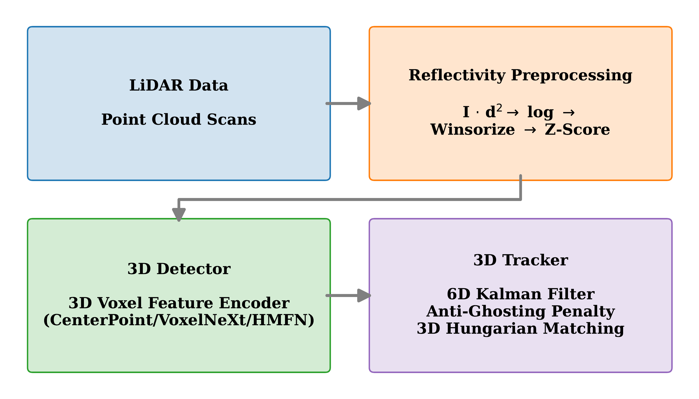
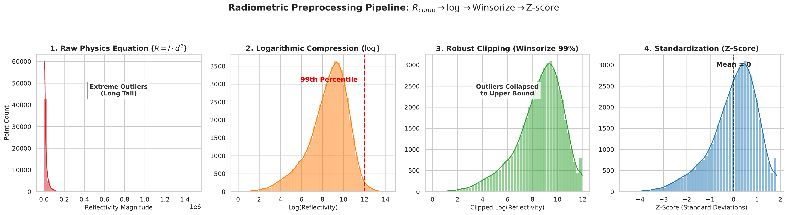
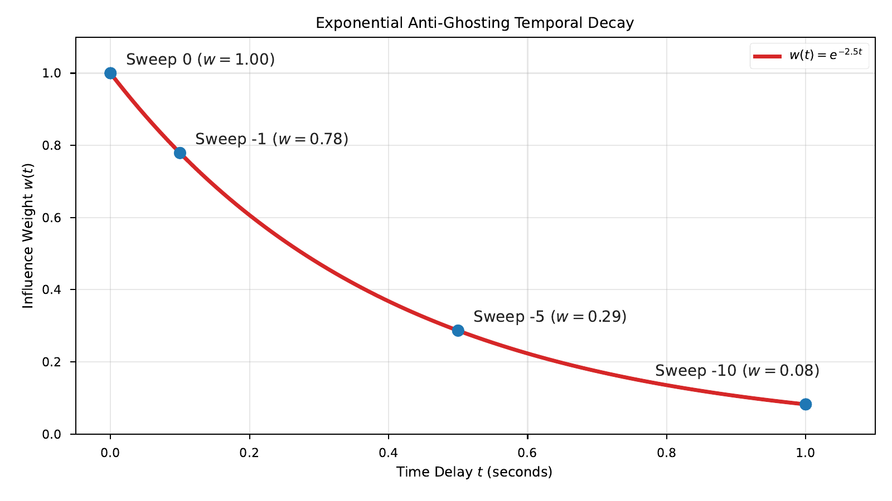
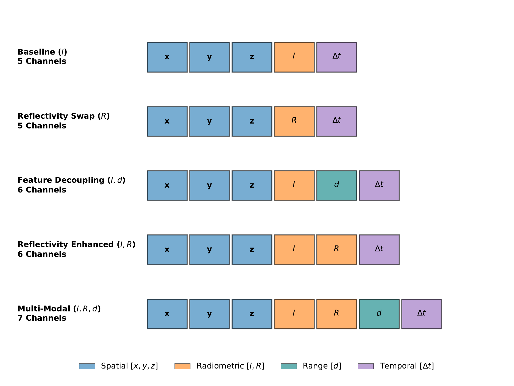
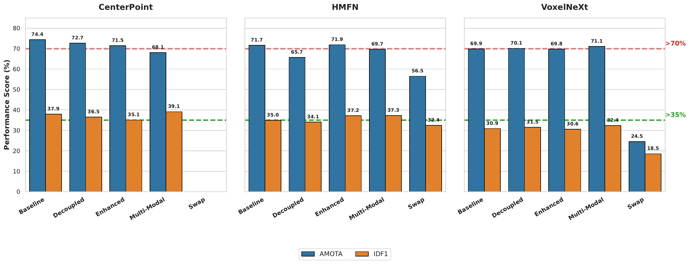
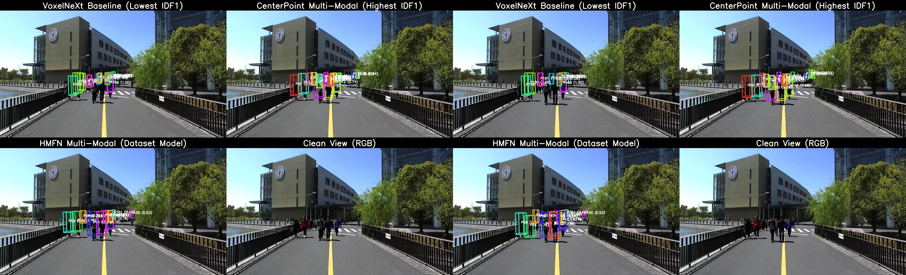
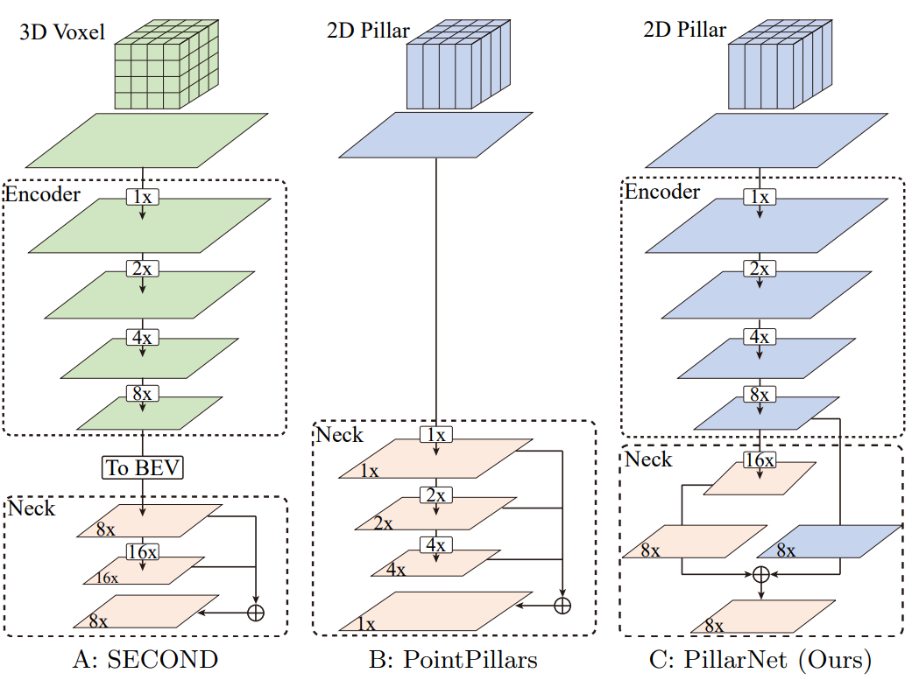
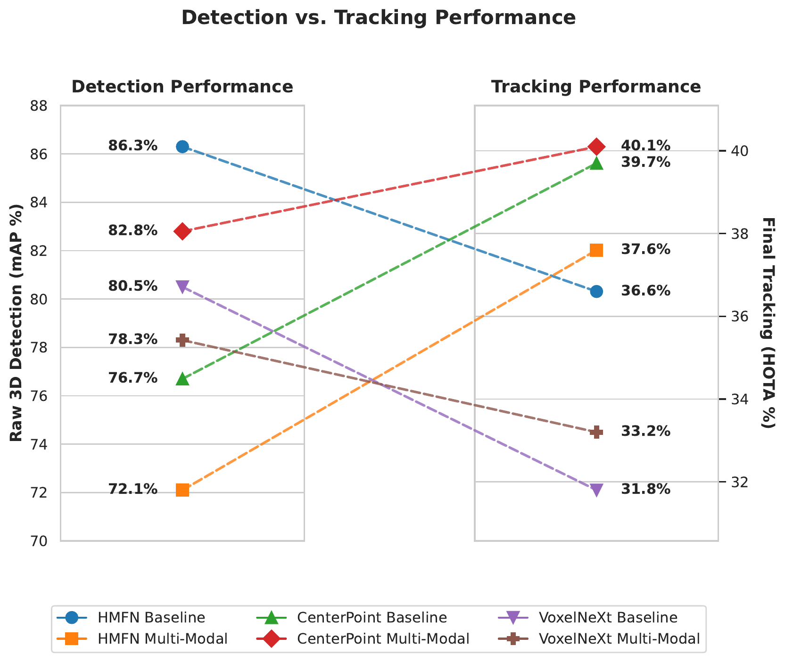

# People Tracking with LiDAR Using Intensity and Reflectivity Data

<p align="center">
  
  <br>
  <em><b>Figure 3.1:</b> Overview of the 3D perception and tracking pipeline. Sequential data flow from raw LiDAR point clouds through radiometric preprocessing, 3D deep detection backbones, and the DeepSORT-lite Kalman filter tracking engine.</em>
</p>

<p align="center">
  <a href="#-abstract--research-overview"></a>
  <a href="#-master-thesis-benchmark-results"></a>
  <a href="#-installation--environment-setup"></a>
  <a href="#-installation--environment-setup"></a>
  <a href="LICENSE"></a>
</p>

> **Master's Thesis**  
> *School of Electrical Engineering, Aalto University*  
> Author: **Eelis Pinomaa**  
> A systematic investigation of radiometric LiDAR representations across 2D, 3D Sparse Voxel, and Hybrid Multi-Scale Attention architectures on dense 128-beam pedestrian crowds.

---

## 📌 Abstract & Research Overview

Accurate 3D multi-object tracking (MOT) of pedestrians in crowded environments is essential for safe autonomous driving and robotics navigation. While 3D coordinates ($x, y, z$) provide structural spatial geometry, raw return **intensity** ($I$) is heavily attenuated across distance by the radar range equation ($P_r \propto \frac{\sigma}{d^4}$ for point targets, or $\frac{\sigma}{d^2}$ for extended Lambertian surfaces).

This thesis investigates whether augmenting neural detectors and kinematic trackers with **calibrated reflectivity** ($R \approx I \cdot d^2$), **feature decoupling** ($I, d$), or **multi-modal fusion** ($I, R, d$) improves pedestrian detection and trajectory continuity in dense crowds.

Using the **Pedestrian-Focus Scene Dataset (PFSD)** featuring high-density 128-beam LiDAR, we systematically benchmark 4 neural architectures across 5 input feature variants, evaluated via a **DeepSORT-lite Kalman Filter state machine** and the **Multi-Metric Triad** (AMOTA, MOTA, HOTA [DetA/AssA/LocA], and IDF1).

---

## 🔬 Radiometric Calibration & Anti-Ghosting Pipeline

### Figure 3.3: Radiometric Preprocessing Pipeline
The raw physics calibration equation ($R = I \cdot d^2$) produces an extreme heavy-tailed distribution with astronomical numerical outliers that destabilize the non-parametric `MeanVFE` (Voxel Feature Encoder). We stabilize this signal via logarithmic compression, 99th-percentile Winsorization (clipping), and Z-score standardization:

<p align="center">
  
  <br>
  <em><b>Figure 3.3:</b> The radiometric calibration pipeline. Raw quadratic scaling is stabilized through logarithmic compression, 99th-percentile Winsorization, and Z-score standardization, neutralizing extreme return spikes before voxelization.</em>
</p>

### Figure 3.2: Anti-Ghosting Temporal Decay
When accumulating multi-sweep temporal point clouds (10 sweeps), moving pedestrians leave smeared material "footprints" in historical sweeps. We introduce an exponential radiometric decay factor $w(t) = e^{-\lambda |t|}$ (with $\lambda = 2.5$) applied exclusively to historical intensity and reflectivity channels:

<p align="center">
  
  <br>
  <em><b>Figure 3.2:</b> Exponential anti-ghosting temporal decay curve ($w(t) = e^{-2.5t}$). Historical material signatures are rapidly suppressed to eliminate ghost footprints while preserving spatial velocity trails for motion estimation.</em>
</p>

---

## 💡 Evaluated Feature Variants

### Figure 3.4: Evaluated Point Feature Configurations

<p align="center">
  
  <br>
  <em><b>Figure 3.4:</b> Five input variants designed to systematically isolate the contributions of spatial geometry, raw intensity, calibrated reflectivity, and range distance.</em>
</p>

1. **Baseline ($I$)**: Retains raw uncalibrated sensor return intensity ($x, y, z, I, t$).
2. **Reflectivity Swap ($R$)**: Replaces raw intensity entirely with calibrated reflectivity ($x, y, z, R, d, t$).
3. **Feature Decoupling ($I, d$)**: Supplies raw intensity and Euclidean range distance as separate, uncoupled channels ($x, y, z, I, d, t$).
4. **Reflectivity-Enhanced ($I, R$)**: Appends calibrated reflectivity directly alongside raw intensity ($x, y, z, I, R, t$).
5. **Multi-Modal ($I, R, d$)**: Fuses calibrated reflectivity, raw intensity, and range distance ($x, y, z, I, R, d, t$).

---

## 📊 Master Thesis Benchmark Results

> **Official Data Source**: Taken directly from Master's Thesis Chapter 5 (`latex/Current_Version/chapters/05_results.tex`), evaluated on the PFSD 128-beam validation benchmark after 160 training epochs.

### Table 5.1: 3D Pedestrian Detection Performance (3D mAP)

Evaluated across four Euclidean distance matching thresholds ($0.5$ m, $1.0$ m, $2.0$ m, and $4.0$ m):

| Model Architecture | Feature Variant | mAP | AP @ 0.5m | AP @ 1.0m | AP @ 2.0m | AP @ 4.0m |
|:---|:---|:---:|:---:|:---:|:---:|:---:|
| **PointPillars** | Baseline ($I$) | 45.70% | 21.77% | 33.96% | 53.39% | 73.70% |
| **PointPillars** | Reflectivity Swap ($R$) | 0.00% | 0.00% | 0.00% | 0.00% | 0.00% |
| **PointPillars** | Feature Decoupling ($I, d$) | 43.10% | 20.35% | 30.88% | 49.70% | 71.49% |
| **PointPillars** | Reflectivity Enhanced ($I, R$) | 0.45% | 0.00% | 0.00% | 0.00% | 1.79% |
| **PointPillars** | Multi-Modal ($I, R, d$) | 0.00% | 0.00% | 0.00% | 0.00% | 0.00% |
| **CenterPoint** | Baseline ($I$) | 76.65% | 71.61% | 74.48% | 78.60% | 81.92% |
| **CenterPoint** | Reflectivity Swap ($R$) | 39.03% | 34.94% | 36.67% | 40.54% | 43.98% |
| **CenterPoint** | Feature Decoupling ($I, d$) | 53.42% | 42.00% | 47.81% | 56.44% | 67.43% |
| **CenterPoint** | Reflectivity Enhanced ($I, R$) | 74.36% | 69.04% | 71.95% | 76.07% | 80.39% |
| **CenterPoint** | **Multi-Modal ($I, R, d$)** | **82.76%** | 77.40% | 80.76% | 84.65% | 88.21% |
| **VoxelNeXt** | Baseline ($I$) | 80.52% | 72.21% | 77.65% | 83.55% | 88.68% |
| **VoxelNeXt** | Reflectivity Swap ($R$) | 31.93% | 20.16% | 24.63% | 33.64% | 49.29% |
| **VoxelNeXt** | Feature Decoupling ($I, d$) | 79.85% | 71.48% | 76.93% | 82.86% | 88.12% |
| **VoxelNeXt** | Reflectivity Enhanced ($I, R$) | 79.20% | 73.27% | 76.30% | 81.48% | 85.74% |
| **VoxelNeXt** | Multi-Modal ($I, R, d$) | 78.35% | 72.28% | 75.50% | 80.66% | 84.95% |
| **HMFN** | **Baseline ($I$)** | **86.35%** | **80.76%** | **84.44%** | **88.10%** | **92.08%** |
| **HMFN** | Feature Decoupling ($I, d$) | 68.73% | 61.67% | 65.85% | 70.36% | 77.05% |
| **HMFN** | Reflectivity Enhanced ($I, R$) | 75.40% | 70.23% | 73.41% | 76.65% | 81.15% |
| **HMFN** | Multi-Modal ($I, R, d$) | 72.07% | 66.27% | 69.57% | 74.02% | 78.41% |
| **HMFN** | Reflectivity Swap ($R$) | 72.90% | 62.79% | 68.11% | 75.57% | 85.11% |

---

### Table 5.2: Multi-Model 3D Pedestrian Tracking Performance

Evaluated on PFSD validation sequences with the DeepSORT-lite Kalman filter tracker at optimal parameter settings:

<p align="center">
  
</p>

| Model Architecture | Feature Variant | AMOTA ↑ | HOTA ↑ | IDF1 ↑ | False Positives (FP) ↓ |
|:---|:---|:---:|:---:|:---:|:---:|
| **CenterPoint** | **Baseline ($I$)** | **0.745** | 0.3973 | 0.3873 | 2,415 |
| **CenterPoint** | Reflectivity Swap ($R$) | 0.000 | 0.0000 | 0.0000 | 0 |
| **CenterPoint** | Feature Decoupling ($I, d$) | 0.727 | 0.3799 | 0.3651 | **540** *(slashed by 78%)* |
| **CenterPoint** | Reflectivity Enhanced ($I, R$) | 0.716 | 0.3737 | 0.3602 | 2,786 |
| **CenterPoint** | **Multi-Modal ($I, R, d$)** | 0.681 | **0.4006** | **0.3912** | **682** *(best continuity)* |
| **VoxelNeXt** | Baseline ($I$) | 0.699 | 0.3175 | 0.3090 | 3,557 |
| **VoxelNeXt** | Reflectivity Swap ($R$) | 0.245 | 0.2013 | 0.1854 | 717 |
| **VoxelNeXt** | Feature Decoupling ($I, d$) | 0.701 | 0.3204 | 0.3154 | **641** *(slashed by 82%)* |
| **VoxelNeXt** | Reflectivity Enhanced ($I, R$) | 0.703 | 0.3210 | 0.3167 | 3,675 |
| **VoxelNeXt** | **Multi-Modal ($I, R, d$)** | **0.711** | **0.3322** | **0.3241** | **534** |
| **HMFN** | Baseline ($I$) | 0.717 | 0.3659 | 0.3496 | 573 |
| **HMFN** | Reflectivity Swap ($R$) | 0.565 | 0.3146 | 0.3244 | 631 |
| **HMFN** | Feature Decoupling ($I, d$) | 0.657 | 0.3488 | 0.3407 | 3,544 |
| **HMFN** | **Reflectivity Enhanced ($I, R$)** | **0.719** | 0.3706 | 0.3720 | 598 |
| **HMFN** | **Multi-Modal ($I, R, d$)** | 0.697 | **0.3761** | **0.3727** | 616 |
| **PointPillars** | Baseline ($I$) | 0.000 | 0.1002 | 0.0893 | 719 |
| **PointPillars** | Reflectivity Swap ($R$) | 0.000 | 0.0777 | 0.0693 | 719 |
| **PointPillars** | Feature Decoupling ($I, d$) | 0.000 | 0.1782 | 0.1519 | 719 |
| **PointPillars** | Reflectivity Enhanced ($I, R$) | 0.000 | 0.0000 | 0.0000 | 719 |
| **PointPillars** | Multi-Modal ($I, R, d$) | 0.000 | 0.0000 | 0.0000 | 719 |

---

## 🔍 Figure 5.2: Qualitative Tracking Comparison

<p align="center">
  
  <br>
  <em><b>Figure 5.2:</b> Qualitative tracking comparison across consecutive frames 053 and 054 in crowded conditions. The panels illustrate key architectural failure modes: HMFN suffers from ID switches (evident from bounding box color changes during dense crossover), VoxelNeXt drops foreground pedestrian proposals, and CenterPoint produces false positive ghost tracks in the upper right quadrant.</em>
</p>

---

## 🔬 Core Academic Discoveries

### 1. The 2D Compression Failure (PointPillars)
<p align="center">
  
</p>

Architectures relying on early vertical compression (collapsing the Z-axis into 2D pillars) completely collapse on dense 128-beam pedestrian crowds (**0.000 AMOTA** across all representations). Compressing the height dimension discards structural vertical geometry, merging street signs, poles, and foliage with pedestrian torsos in bird's-eye view (BEV) and provoking insurmountable False Positive explosions.

### 2. The Reflectivity Paradox (Why $R = I \cdot d^2$ Fails in Tracking)
Directly replacing raw Intensity with physical reflectivity ($R$) severely degrades tracking accuracy across all backbones (dropping HMFN from 0.717 to 0.565 AMOTA). The inverse-square scaling drastically amplifies distant retro-reflective background objects. Because the detector assigns these clutter objects confidence scores that overlap with genuine pedestrians, downstream tracking algorithms suffer severe trajectory fragmentation and ID switches.

<p align="center">
  
</p>

### 3. Feature Decoupling Slashes False Positives
Supplying intensity and range distance as independent channels $(I, d)$ allows the multi-layer perceptrons within the Voxel Feature Encoder (VFE) to natively learn range-conditioned calibrations. 
- On **CenterPoint**, false positives dropped from **2,415 to 540** (-78%).
- On **VoxelNeXt**, false positives dropped from **3,557 to 641** (-82%).

### 4. Scene Purity vs. Trajectory Continuity Trade-off
- **AMOTA** heavily penalizes false positives and favors conservative detections (CenterPoint Baseline reaches 0.745 AMOTA).
- **HOTA & IDF1** peak under the **Multi-Modal ($I, R, d$)** variant across all volumetric backbones (CenterPoint secures benchmark-best **0.4006 HOTA** and **0.3912 IDF1**). Calibrated reflectivity acts as a persistent radiometric signature that enables the tracker to maintain target identity through dense occlusions.

---

## 🎯 Table 5.3: Optimal Tracker Parameters (Reproducibility)

The table records the exact distance gating threshold ($D$), confidence score filter ($F$), and reflectivity appearance penalty weight ($R$) identified via grid search:

| Model Architecture | Best AMOTA Parameters | Best HOTA Parameters | Best IDF1 Parameters |
|:---|:---|:---|:---|
| **CenterPoint Baseline** | (D: 40.0m, F: 0.6, R: 0.0x) | (D: 40.0m, F: 0.6, R: 0.0x) | (D: 40.0m, F: 0.6, R: 0.0x) |
| **CenterPoint Reflectivity Swap** | (D: 30.0m, F: 0.5, R: 0.0x) | (D: 30.0m, F: 0.5, R: 0.0x) | (D: 30.0m, F: 0.5, R: 0.0x) |
| **CenterPoint Feature Decoupling** | (D: 40.0m, F: 0.5, R: 0.0x) | (D: 30.0m, F: 0.6, R: 0.0x) | (D: 30.0m, F: 0.6, R: 0.0x) |
| **CenterPoint Reflectivity Enhanced** | (D: 30.0m, F: 0.5, R: 0.0x) | (D: 30.0m, F: 0.6, R: 0.0x) | (D: 30.0m, F: 0.6, R: 0.0x) |
| **CenterPoint Multi-Modal** | (D: 40.0m, F: 0.5, R: 0.0x) | (D: 40.0m, F: 0.5, R: 0.0x) | (D: 40.0m, F: 0.5, R: 0.0x) |
| **VoxelNeXt Baseline** | (D: 30.0m, F: 0.5, R: 0.0x) | (D: 40.0m, F: 0.5, R: 0.0x) | (D: 40.0m, F: 0.5, R: 0.0x) |
| **VoxelNeXt Reflectivity Swap** | (D: 30.0m, F: 0.5, R: 0.0x) | (D: 40.0m, F: 0.5, R: 0.16x) | (D: 40.0m, F: 0.5, R: 0.16x) |
| **VoxelNeXt Feature Decoupling** | (D: 30.0m, F: 0.5, R: 0.0x) | (D: 30.0m, F: 0.5, R: 0.0x) | (D: 30.0m, F: 0.5, R: 0.0x) |
| **VoxelNeXt Reflectivity Enhanced** | (D: 40.0m, F: 0.5, R: 0.0x) | (D: 30.0m, F: 0.5, R: 0.0x) | (D: 30.0m, F: 0.5, R: 0.0x) |
| **VoxelNeXt Multi-Modal** | (D: 30.0m, F: 0.5, R: 0.0x) | (D: 30.0m, F: 0.6, R: 0.0x) | (D: 40.0m, F: 0.5, R: 0.0x) |
| **HMFN Baseline** | (D: 40.0m, F: 0.5, R: 0.0x) | (D: 30.0m, F: 0.5, R: 0.0x) | (D: 30.0m, F: 0.5, R: 0.0x) |
| **HMFN Reflectivity Swap** | (D: 40.0m, F: 0.5, R: 0.22x) | (D: 40.0m, F: 0.5, R: 0.22x) | (D: 40.0m, F: 0.5, R: 0.22x) |
| **HMFN Feature Decoupling** | (D: 30.0m, F: 0.5, R: 0.0x) | (D: 30.0m, F: 0.6, R: 0.0x) | (D: 30.0m, F: 0.6, R: 0.0x) |
| **HMFN Reflectivity Enhanced** | (D: 40.0m, F: 0.5, R: 0.0x) | (D: 30.0m, F: 0.6, R: 0.0x) | (D: 40.0m, F: 0.6, R: 0.0x) |
| **HMFN Multi-Modal** | (D: 40.0m, F: 0.5, R: 0.0x) | (D: 40.0m, F: 0.6, R: 0.0x) | (D: 40.0m, F: 0.5, R: 0.0x) |
| **PointPillars Baseline** | (D: 40.0m, F: 0.5, R: 0.0x) | (D: 30.0m, F: 0.5, R: 0.0x) | (D: 30.0m, F: 0.5, R: 0.0x) |
| **PointPillars Reflectivity Swap** | (D: 30.0m, F: 0.5, R: 0.0x) | (D: 30.0m, F: 0.5, R: 0.0x) | (D: 30.0m, F: 0.5, R: 0.1x) |
| **PointPillars Feature Decoupling** | (D: 30.0m, F: 0.5, R: 0.0x) | (D: 30.0m, F: 0.6, R: 0.0x) | (D: 30.0m, F: 0.6, R: 0.0x) |
| **PointPillars Reflectivity Enhanced** | (D: 40.0m, F: 0.5, R: 0.0x) | (D: 30.0m, F: 0.6, R: 0.0x) | (D: 40.0m, F: 0.6, R: 0.0x) |
| **PointPillars Multi-Modal** | (D: 40.0m, F: 0.5, R: 0.0x) | (D: 40.0m, F: 0.6, R: 0.0x) | (D: 40.0m, F: 0.5, R: 0.0x) |

---

## 🗂️ Repository Structure

```
├── core/                                # Core tracking and projection algorithms
│   ├── person_tracker.py                # DeepSORT-lite Kalman Filter state machine & Hungarian matching
│   ├── person_tracker_appearance.py     # Reflectivity signature appearance / Re-ID cost matrix tracker
│   ├── person_tracker_cascade.py        # Two-stage association cascade tracker
│   ├── person_tracker_reward.py         # Distance & reward-weighted tracker
│   ├── dl_tracker.py                    # Deep learning detector inference wrapper
│   ├── lidar_projection.py             # 3D LiDAR to 2D camera coordinate frame projection
│   └── token_to_scene.tsv               # PFSD token-to-scene lookup table
├── configs/                             # Model & dataset configurations
│   ├── pfsd_dataset_*.yaml              # Dataset definitions (baseline, decoupled, swap, kitchen_sink)
│   ├── pfsd_hmfn_*.yaml                 # HMFN variant configurations
│   ├── pfsd_centerpoint_*.yaml          # CenterPoint variant configurations
│   ├── pfsd_voxelnext_*.yaml            # VoxelNeXt variant configurations
│   └── pfsd_pp_multihead_*.yaml         # PointPillars variant configurations
├── PFSD/                                # Customized PFSD detection framework (forked OpenPCDet)
│   ├── pcdet/datasets/nuscenes/         # Feature-aware nuScenes/PFSD dataloader
│   └── ...
├── OpenPCDet/                           # OpenPCDet 3D perception framework
├── tools/                               # Evaluation, tuning, and visualization tools
│   ├── evaluate_pfsd_tracking.py        # Master PFSD tracking evaluator (AMOTA / MOTA)
│   ├── compute_pfsd_hota.py             # Computes HOTA, DetA, AssA, and LocA
│   ├── compute_pfsd_idf1.py             # Computes IDF1 trajectory continuity
│   ├── export_nusc_tracking_gt.py       # Ground-truth trajectory exporter
│   ├── extract_raw_predictions.py       # Caches unthresholded detections & reflectivity signatures
│   ├── tune_tracking_frontiers.py       # High-speed hyperparameter grid search for dynamic thresholds
│   ├── reflectivity_normalization.py   # Robust reflectivity filter (Winsorization + Z-score)
│   ├── run_pfsd_visual_debug.py         # 3D bounding box visual debug on camera feeds
│   ├── visualize_projection.py          # Point cloud to video feed projection
│   └── generate_thesis_tables.py        # Summary table generation
├── docs/                                # Thesis figures, charts, and methodology notes
│   ├── assets/                          # Embedded PNG/JPG figures and diagrams
│   ├── charts/                          # Figure generator scripts (.py) and PDFs
│   ├── architecture/                    # System architecture diagrams
│   └── processAndFindings.md            # Technical development log
├── results/                             # Benchmark evaluation logs and metrics summaries
│   ├── final_thesis_results_all.md      # Consolidated master metrics table
│   └── ...                              # Per-model JSON metrics and evaluation plots
├── weights/                             # Directory for model checkpoints (.pth)
│   └── README.md                        # Checkpoint inventory and instructions
├── requirements.txt                     # Python dependencies
├── setup_env.sh                         # Automated environment setup script
└── README.md
```

---

## ⚙️ Installation & Quickstart

### 1. Setup Environment
```bash
git clone https://github.com/Jeejeejeelis/People-Tracking-with-LiDAR-Using-Intensity-and-Reflectivity-Data.git
cd People-Tracking-with-LiDAR-Using-Intensity-and-Reflectivity-Data

chmod +x setup_env.sh
./setup_env.sh
```

### 2. Session Activation
In every new shell session:
```bash
source venv/bin/activate
export PYTHONPATH=$(pwd):$(pwd)/PFSD:$(pwd)/OpenPCDet:$PYTHONPATH
```

---

## 🚀 Tracking Evaluation & Reproduction

### 1. Run 3D Multi-Object Tracking
```bash
python tools/evaluate_pfsd_tracking.py \
    --cfg_file configs/pfsd_hmfn_baseline.yaml \
    --ckpt weights/hmfn_baseline_160.pth \
    --score_thresh 0.5 \
    --dist_thresh 40.0
```

### 2. Evaluate HOTA & Trajectory Continuity (IDF1)
```bash
# 1. Export ground truth trajectories
python tools/export_nusc_tracking_gt.py

# 2. Compute HOTA
python tools/compute_pfsd_hota.py --pred_dir results/hmfn_baseline_160/tracking_eval

# 3. Compute IDF1
python tools/compute_pfsd_idf1.py --pred_dir results/hmfn_baseline_160/tracking_eval
```

---

## 🎯 High-Speed Hyperparameter Tuning

To run grid searches across millions of distance gates and confidence filters without repeating deep neural network inference:

1. **Cache unthresholded detections**:
   ```bash
   python tools/extract_raw_predictions.py \
       --cfg_file configs/pfsd_centerpoint_swap.yaml \
       --ckpt weights/pfsd_centerpoint_swap_160.pth \
       --output_pkl results/cp_swap_raw.pkl
   ```

2. **Execute hyperparameter search**:
   ```bash
   python tools/tune_tracking_frontiers.py \
       --pkl results/cp_swap_raw.pkl \
       --dist_range 15 45 \
       --far_penalty 0.1 0.7
   ```

---

## 📖 Citation

If you find this codebase or research useful, please cite the Master's Thesis:

```bibtex
@mastersthesis{pinomaa2026peopletracking,
  author    = {Eelis Pinomaa},
  title     = {People Tracking with LiDAR Using Intensity and Reflectivity Data},
  school    = {Aalto University, School of Electrical Engineering},
  year      = {2026},
  address   = {Espoo, Finland}
}
```

---

## 📚 Acknowledgments
- **PFSD Dataset**: *PFSD: A Multi-Modal Pedestrian-Focus Scene Dataset for Rich Tasks in Semi-Structured Environments* (VSLab Robotics, 2025). [https://github.com/VSlabRobotics/PFSD](https://github.com/VSlabRobotics/PFSD)
- **OpenPCDet**: OpenPCDet Development Team. [https://github.com/open-mmlab/OpenPCDet](https://github.com/open-mmlab/OpenPCDet)
- **NuScenes**: Caesar et al., *nuScenes: A multimodal dataset for autonomous driving*, CVPR 2020.
- **TrackEval**: Luiten et al., *TrackEval: Multi-Object Tracking Evaluation Toolkit*, 2020.
